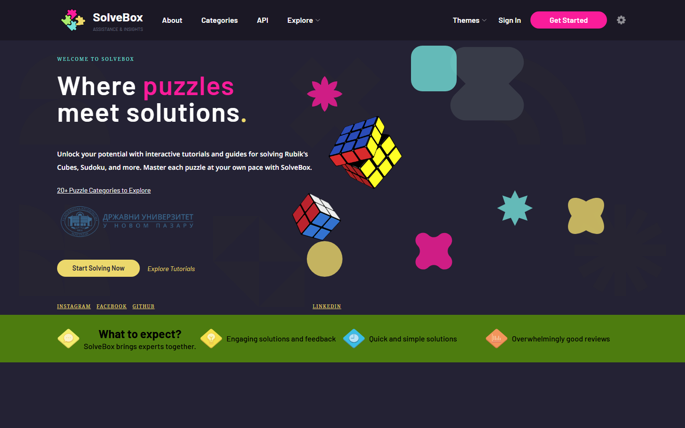

# SolveBox

Live at https://solve-box.vercel.app

Guides for solving classic puzzles, in English and Serbian. Each puzzle page
explains the puzzle, its history and its common variations, with links to
solvers, timers and communities.



## Features

- Guides for seven puzzles: Rubik's Cube, Sudoku, crosswords, jigsaw puzzles,
  the Tower of Hanoi, the 15 puzzle and logic grid puzzles.
- English and Serbian (Cyrillic), switchable on every page.
- Thirteen colour themes, remembered between visits.
- Newsletter sign-up in every page footer and on the newsletter page, and a
  feedback form on the contact page. The feedback form is a demo: it shows
  your review on a thank-you page but does not send it anywhere.
- Sign in and sign up. This is a demo: the backend checks its own accounts
  (bcrypt hashes, never sent to the browser), and accounts made with sign-up
  are kept in `localStorage`. The live backend has one demo account:
  `demo@solvebox.dev` / `SolveBox-demo1`.
- A small public JSON API with the puzzle data (see the API page on the site).

## Stack

- `frontend/`: plain HTML and JavaScript modules, styled with Tailwind CSS 3.
  The compiled `styles/output.css` is committed, so the site needs no build
  step. Hosted on Vercel.
- `backend/`: an Express server that serves the puzzle data and reviews
  from JSON files in `backend/src/data`, checks demo sign-ins, and stores
  newsletter sign-ups. Hosted on Render at https://solvebox.onrender.com.

The frontend calls the Render backend directly, so the live site needs it to
be up. Render's free tier sleeps when idle, so the first request after a quiet
spell can take up to a minute.

## Run it locally

Frontend (any static server works; the repo uses VS Code Live Server):

```bash
cd frontend
npm install
npm run dev        # rebuilds styles/output.css as you edit
```

Then open `frontend/index.html` with a static server, such as Live Server on
port 5501.

Backend:

```bash
cd backend
npm install
npm start          # http://localhost:5000
```

The frontend points at the hosted backend. To use a local one, change
`https://solvebox.onrender.com` to `http://localhost:5000` in the files under
`frontend/js`.

No environment variables are needed. Accounts and newsletter sign-ups live in
`backend/src/data/accounts.json` and `subscribers.json`, which are not
committed; without them the server uses `accounts.example.json` and
`subscribers.example.json`. Each account is `{ "email", "passwordHash" }`
with a bcrypt hash. Optional: `PORT`, `ACCOUNTS_FILE`, `SUBSCRIBERS_FILE`.

## Backend endpoints

| Method | Path | Returns |
| --- | --- | --- |
| GET | `/english`, `/srpski` | All puzzles, or one with `?name=` |
| GET | `/english/preview`, `/srpski/preview` | Puzzle summaries, optionally `?name=` |
| GET | `/reviews` | Sample reviews (no longer shown on the site) |
| GET | `/accounts/exists?email=` | `{ "exists": true | false }`, used by sign-up |
| POST | `/auth/signin` | Checks `{ "email", "password" }`; `{ "email" }` or 401 |
| GET | `/api-data` | Content for the API page |
| POST | `/subscribe` | Adds `{ "email": "..." }` to the newsletter list |
